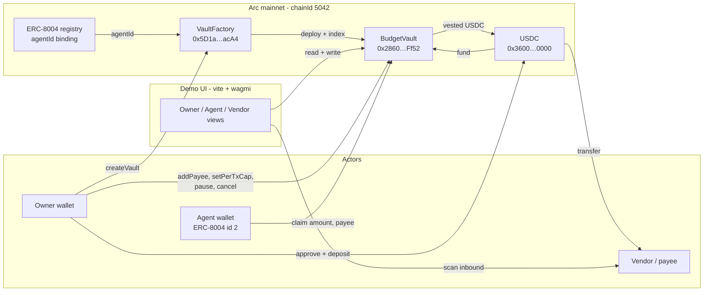
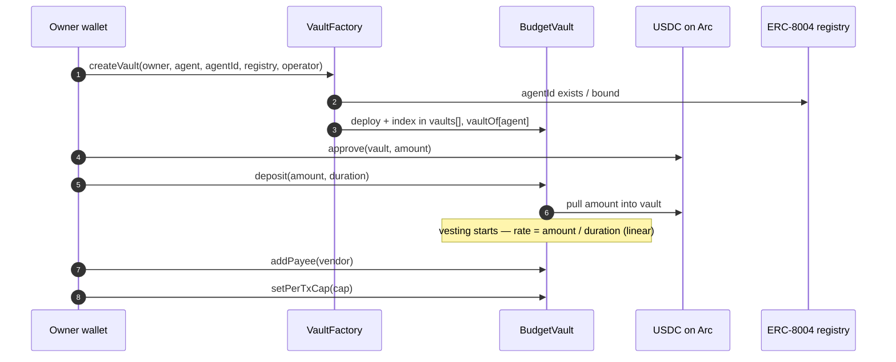
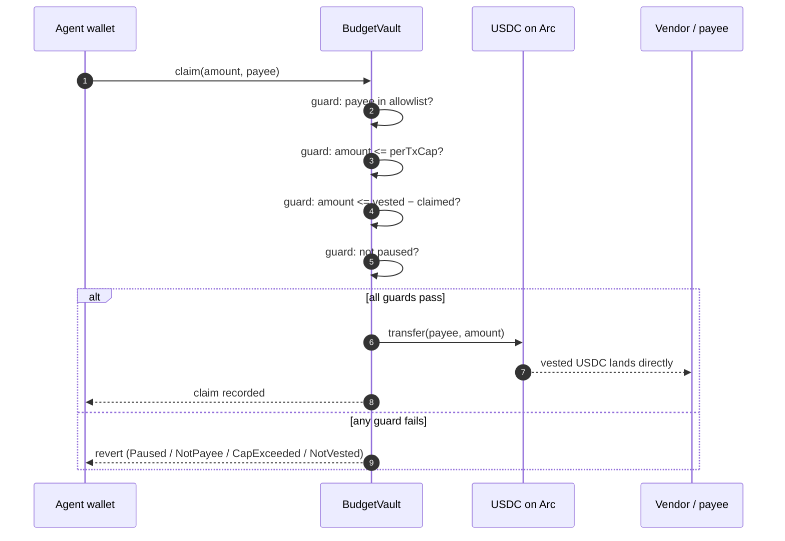

# Agent Allowance — Arc mainnet submission

Agent Allowance is an onchain USDC budget vault for AI agents. x402 lets an agent pay for things, but a funded key is an unlimited budget — this project turns the budget into code. The owner funds a vault once, the deposit vests linearly (Sablier-style), and the agent can only claim what already vested, only to allowlisted payees, inside a per-transaction cap. Every guard lives in the contract, not in a promise. The full lifecycle — factory deploy, vault create, deposit, allowlist, cap, three real claims — is verified on Arc mainnet (`eip155:5042`).

- **Landing page:** [agentbadge.xyz/hackathon/agent-allowance](https://agentbadge.xyz/hackathon/agent-allowance)
- **Write-up:** [agentbadge.xyz/blog/arc-c31-agent-allowance](https://agentbadge.xyz/blog/arc-c31-agent-allowance)
- **Network:** Arc mainnet, chainId `5042`
- **Repo:** [github.com/spreadzp/agent-budget-vault](https://github.com/spreadzp/agent-budget-vault)
- **Status:** production, full lifecycle verified on-chain (section 1)
- **Demo video:** narrated EN/RU slide videos ship in the submission repo (`docs/video/agent-allowance-demo/`)

---

## 1. Mainnet proof

The demo vault ran a complete owner → agent → vendor cycle on Arc mainnet. Every row below is a real transaction on explorer.arc.io.

| # | Step | Transaction |
| --- | ------ | ------------- |
| 1 | `approve` 3 USDC to vault | [`0xfb313a05…0b1aa`](https://explorer.arc.io/tx/0xfb313a05825556aa0b4773a47fb1f2cc1587a20edb835e65d7f1909156e0b1aa) |
| 2 | `deposit` 3 USDC — vesting starts | [`0xaf0b2dd1…d5a56`](https://explorer.arc.io/tx/0xaf0b2dd109690824f7d573df2563eb83b49fe2cb901952fccd4c1e98119d5a56) |
| 3 | `addPayee` (vendor) | [`0x92a234f6…73787`](https://explorer.arc.io/tx/0x92a234f6c6ad1152bf64911a5aa0a312eacf8beb49c89189a85c6b7833073787) |
| 4 | `setPerTxCap` 1 USDC | [`0xc927d0ac…94a54`](https://explorer.arc.io/tx/0xc927d0ac15518b31a05855ab2a8de7100123b90f562bb9bf0e760990f1194a54) |
| 5 | `claim` → vendor (+55 units) | [`0xab128632…9013d`](https://explorer.arc.io/tx/0xab1286328863f5ec4dbb9b040587114fc3966b40506dfc2feb5a85a375d9013d) |
| 6 | `claim` → vendor (+30, submitted from the Agent UI) | [`0x99a6418d…d0c6e`](https://explorer.arc.io/tx/0x99a6418d86ac4cb8477a44402bd076bca45fa7d205b04244fce3734fa97d0c6e) |
| 7 | `claim` → vendor (+30, block 27082200) | [`0x5a29b45d…509b5`](https://explorer.arc.io/tx/0x5a29b45d133338516ca88ad96017bc8ec79a8ef206b6d5767a74956f6c8509b5) |

Vendor USDC balance moved **99,020 → 99,135 units (+115 over 3 claims)** — all inbound, none signable by the agent beyond the allowlist and cap.

Contracts and actors (open on explorer.arc.io):

| Item | Value |
| ------ | ------- |
| VaultFactory | [`0x5D1a014e1FFE3b777F0946C2dd75A7d3aecdacA4`](https://explorer.arc.io/address/0x5D1a014e1FFE3b777F0946C2dd75A7d3aecdacA4) (deploy tx `0x50e3f37b…b463`) |
| BudgetVault (demo, agentId 2) | [`0x2860258CAf3e21c65517233aBa1e876D16D4Ff52`](https://explorer.arc.io/address/0x2860258CAf3e21c65517233aBa1e876D16D4Ff52) (create tx `0x8fb2a823…d6bf`) |
| USDC (Arc native) | [`0x3600000000000000000000000000000000000000`](https://explorer.arc.io/address/0x3600000000000000000000000000000000000000) |
| Owner wallet | [`0xB42fCD7Fe2008f39c9c034772C960cD88C5f23b0`](https://explorer.arc.io/address/0xB42fCD7Fe2008f39c9c034772C960cD88C5f23b0) |
| Agent wallet | [`0xcdd23d104AA4C10DE65F4DD0571eDfeC0458699d`](https://explorer.arc.io/address/0xcdd23d104AA4C10DE65F4DD0571eDfeC0458699d) — bound to ERC-8004 agentId `2` |
| Vendor / payee | [`0x9a664574282b61d31f5A4f22DE63c8Ad248e95A5`](https://explorer.arc.io/address/0x9a664574282b61d31f5A4f22DE63c8Ad248e95A5) |
| ERC-8004 registry | `0x8004A169FB4a3325136EB29fA0ceB6D2e539a432` |

The earlier testnet run on Arc (vault `0x1eFbDB636211f2Ecc3295c01C77000633E957DEa`) exercised the full edge-case matrix — pause blocks claims, `topup` extends the stream, `cancel` returns unvested funds to the owner, and a `claim` after cancel pays only what had vested. Documented in the repo (`docs/e2e-run.md`).

---

## 2. Actors

- **Owner.** The human or company holding the keys. Creates the vault through the factory, deposits USDC, manages the payee allowlist and the per-transaction cap, and can pause or cancel at any time.
- **Agent.** An AI agent or bot with its own Arc wallet (this demo binds it to ERC-8004 agentId 2). It calls `claim(amount, payee)` — nothing else. It cannot move funds to itself unless the owner allowlisted it, cannot exceed the cap, and cannot touch unvested USDC.
- **Vendor / payee.** Any allowlisted address that receives vested USDC directly from the vault. It confirms payments by watching its own address — no trust in the agent's report needed.
- **BudgetVault.** One vault per agent, deployed by the factory. Holds the deposited USDC, tracks the linear vesting schedule and total claimed, and enforces every guard at claim time.
- **VaultFactory.** Thin registry: `createVault(owner, agent, agentId, registry, operator)` deploys a fresh `BudgetVault` and indexes it in `vaults[]` / `vaultOf[agent]`.
- **Demo UI.** A three-role vite + wagmi board (Owner / Agent / Vendor) wired to the live vault — the +30-unit claim above was submitted from the Agent view itself.

---

## 3. Architecture



---

## 4. Flow A: owner sets up a vault



Why the order matters:

- **Identity bound at creation.** `agentId` from ERC-8004 is baked into the vault — the allowance is tied to a verifiable agent identity, not just a keypair.
- **Deposit starts the clock.** Vesting accrues from the deposit transaction — no separate "start" call, no way for the agent to claim ahead of the schedule.
- **Policy before claims.** The allowlist and cap are owner-only writes; the agent-facing surface is just `claim`.

---

## 5. Flow B: the agent claims vested funds



Every check runs in-contract on every claim — the agent never holds withdrawal rights, only a bounded claim call.

---

## 6. Flow C: owner pause and cancel (emergency path)

```mermaid
sequenceDiagram
  autonumber
  participant Owner as Owner wallet
  participant Vault as BudgetVault
  participant USDC as USDC on Arc

  Owner->>Vault: pause()
  Note over Vault: claim() reverts with "Paused" — verified on testnet run
  Owner->>Vault: unpause() or cancel()
  alt unpause
    Note over Vault: claims resume under same policy
  else cancel
    Vault->>USDC: return unvested amount to owner
    Note over Vault: stream closed; only already-vested remains claimable
  end
```

On the testnet e2e this exact path ran: pause → claim reverted (`Paused`) → unpause → `topup` extended the stream → `cancel` refunded 6.18 USDC → post-cancel `claim` paid only the vested remainder.

---

## 7. Contract surface

| Function | Caller | Purpose |
| ---------- | -------- | --------- |
| `createVault(owner, agent, agentId, registry, operator)` | anyone (factory) | Deploy + index a vault |
| `deposit(amount, duration)` | owner | Fund; starts linear vesting |
| `topup(amount, newDuration)` | owner | Add funds, extend the stream |
| `addPayee / removePayee` | owner | Manage the claim allowlist |
| `setPerTxCap(cap)` | owner | Bound a single claim |
| `claim(amount, payee)` | agent | Pull vested USDC to an allowlisted payee |
| `pause / unpause` | owner | Freeze or resume claims |
| `cancel` | owner | Return unvested USDC, close the stream |
| `vaults[]`, `vaultOf[agent]` | view | Factory indexes |

Four enforced guards, in the contract not the frontend: **payee allowlist**, **per-transaction cap**, **vested − claimed bound**, **pause flag**.

---

## 8. What this is not claiming

- **Not an audited contract.** `docs/audit.md` in the repo is an honest self-review; 46/46 Foundry tests pass, but no external audit was done.
- **Not a general paymaster.** The vault pays allowlisted payees only — it is an allowance rail, not a wallet.
- **No x402 settlement inside the vault.** x402 is the payment standard this composes with; the vault itself is a plain ERC-20 custody + vesting contract.
- **Demo-scale amounts.** The mainnet proof moves real USDC on a deliberately small vault; the point is the enforced policy, not the volume.

---

## Links

- Repo: [github.com/spreadzp/agent-budget-vault](https://github.com/spreadzp/agent-budget-vault)
- Landing: [agentbadge.xyz/hackathon/agent-allowance](https://agentbadge.xyz/hackathon/agent-allowance)
- Article (C31): [agentbadge.xyz/blog/arc-c31-agent-allowance](https://agentbadge.xyz/blog/arc-c31-agent-allowance)
- Explorer: [explorer.arc.io](https://explorer.arc.io)
