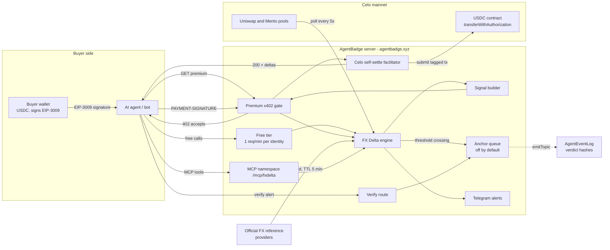
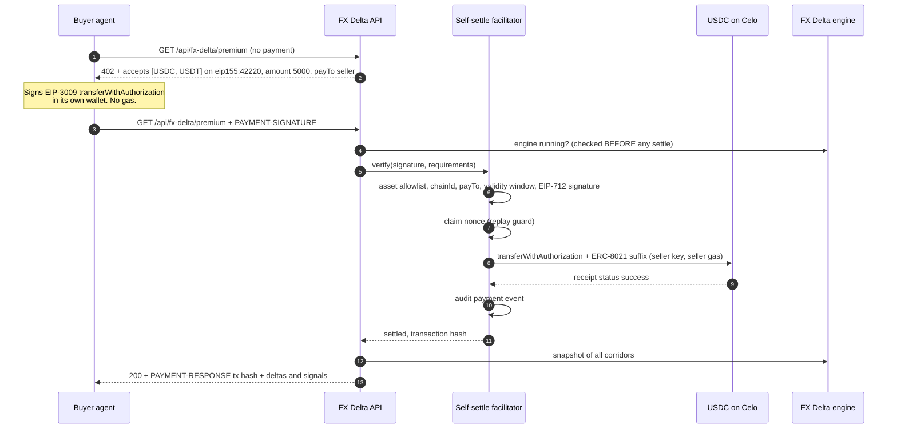
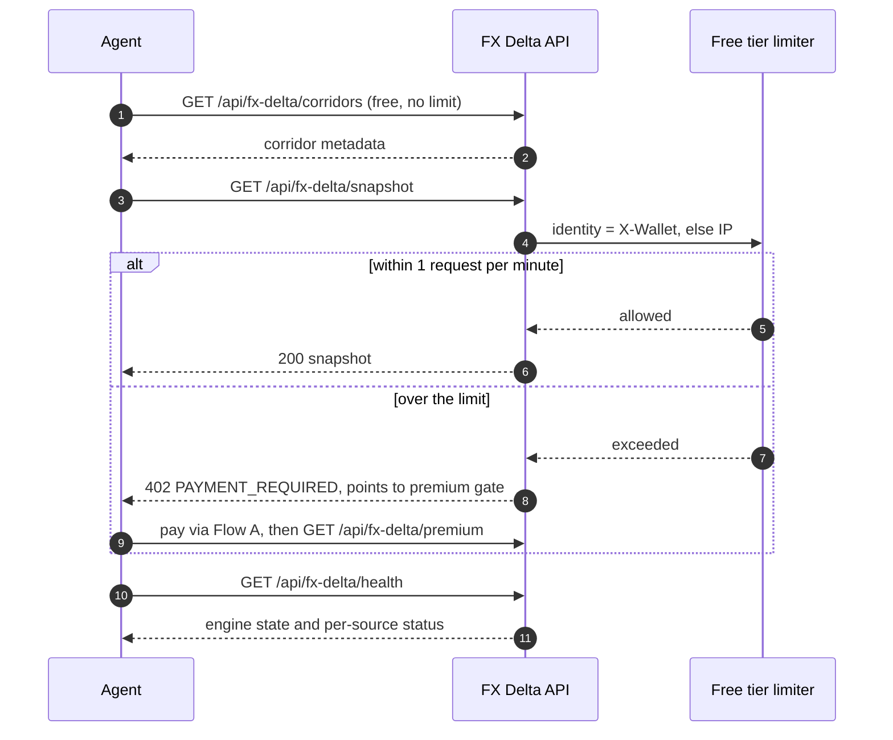
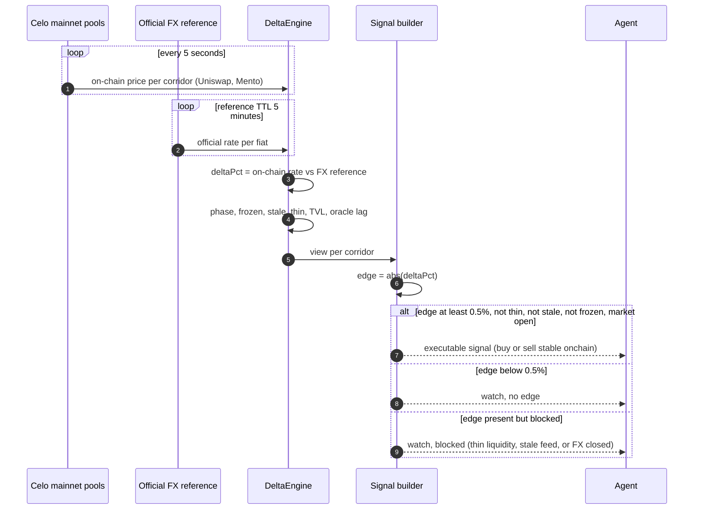
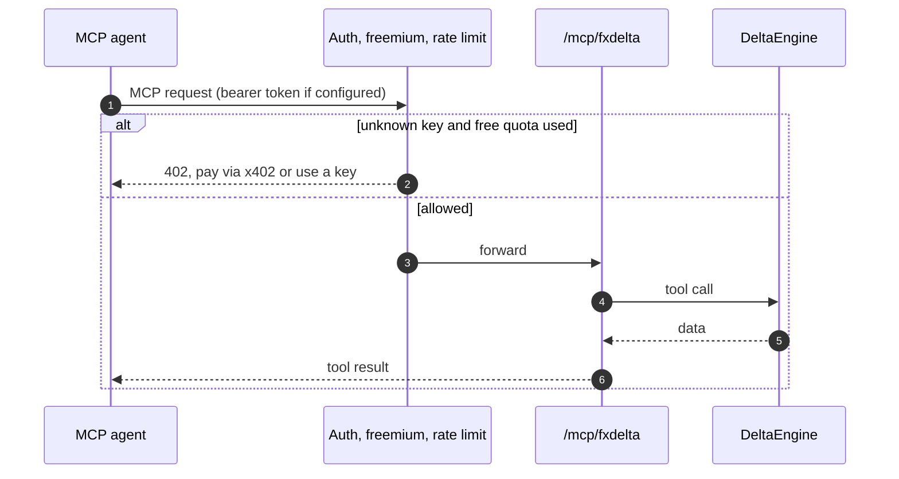

# FX Delta Agent — Celo mainnet x402 submission

FX Delta is a paid x402 API for AI agents. It compares live stablecoin prices on Celo DEX pools with official FX reference rates for 22 corridors and returns a machine-readable trade signal (buy, sell, or watch) per corridor. An agent pays **0.005 USDC per call** on **Celo mainnet** (`eip155:42220`). The seller settles the payment itself through a tagged transaction, and every paid settle can be checked on Blockscout.

- **Live endpoint:** `https://agentbadge.xyz/api/fx-delta/premium`
- **Network:** Celo mainnet, chainId `42220`
- **Price:** 5000 base units = 0.005 USDC (USDT accepted at the same price)
- **Status:** production, mainnet payment verified on-chain (section 1)
- **Demo video:** [FX Delta Agent — paid x402 API on Celo mainnet](https://youtu.be/XVlZYe79jQI)

---

## 1. Mainnet proof

Payment executed on 2026-10-20 by a real buyer agent wallet (`buymain`) through the `@celo/buy` x402 client, against the production endpoint.

| Item | Value |
|------|-------|
| Settle transaction | [`0x7f292710b92b0684b272872d9829899c3a5dcf83819df98908b1bd391355b6b2`](https://celo.blockscout.com/tx/0x7f292710b92b0684b272872d9829899c3a5dcf83819df98908b1bd391355b6b2) |
| Block / status | 80576414 / Success |
| Call | `transferWithAuthorization` (selector `0xe3ee160e`) on USDC |
| Token | USDC `0xcebA9300f2b948710d2653dD7B07f33A8B32118C` |
| Transfer | 0.005 USDC, buyer → seller |
| Buyer (agent wallet) | `0x4a2f11B5FC4A9799B94Cc236C2D3d9d2EE4E6Bb0` |
| Seller (payTo, gas payer) | `0x0F711f822EF1Ba1736F62CAAbb51F5502758186e` |
| Attribution | ERC-8021 tag `celo_24acc530146f` in the settle calldata (verified by decoding the transaction input) |

Balances before and after the paid call:

| Wallet | Asset | Before | After | Change |
|--------|-------|--------|-------|--------|
| Buyer | USDC | 4.840 | 4.835 | −0.005 (the payment) |
| Buyer | CELO | 0 | 0 | 0 (buyer signs, pays no gas) |
| Seller | USDC | 0 | 0.005 | +0.005 (payment received) |
| Seller | CELO | 1.997 | 1.976 | −0.021 (gas for the settle tx) |

---

### Transaction index (click to verify)

All hashes below were checked on-chain. Mainnet links open Celo mainnet Blockscout, testnet links open Celo Sepolia Blockscout.

| # | Network | Transaction | Sender (submitter) | What it did | Amount | Result |
|---|---------|-------------|--------------------|-------------|--------|--------|
| 1 | Celo mainnet | [`0x7f292710…55b6b2`](https://celo.blockscout.com/tx/0x7f292710b92b0684b272872d9829899c3a5dcf83819df98908b1bd391355b6b2) | seller `0x0F71…186e` | FX Delta paid call: `transferWithAuthorization`, buyer `0x4a2f…` to seller, ERC-8021 tagged | 0.005 USDC | Success, block 80576414 |
| 2 | Celo mainnet | [`0x1d685a43…f83991`](https://celo.blockscout.com/tx/0x1d685a4332e392704f61fbd1b88600e2aba27c4f12b772f55e2f868d41f83991) | relayer `0x0d74…fb48` | `buymain` pays usebuy.ai Google Places, HTTP 200 | 0.04 USDC | Success, block 80528714 |
| 3 | Celo mainnet | [`0xa98a2213…ba59588`](https://celo.blockscout.com/tx/0xa98a22130b06a2669a9f74bc4da9ac6658196f42d3bd3a4bb23de7362ba59588) | relayer `0x0d74…fb48` | `buymain` pays usebuy.ai Google Places, upstream returned HTTP 400 | 0.04 USDC | Success on-chain. The payment settled even though the upstream call failed. |
| 4 | Celo mainnet | [`0xc93155b1…ee8313c`](https://celo.blockscout.com/tx/0xc93155b1a66095b3f996fcdb2a5ce581d9610f8b8e050a5390de42cf7ee8313c) | relayer `0x0d74…fb48` | `buymain` pays usebuy.ai chat completion (cencori), HTTP 200 | 0.01 USDC | Success, block 80526114 |
| 5 | Celo mainnet | [`0x01a4193e…4be03`](https://celo.blockscout.com/tx/0x01a4193e71bd58fea4dc82c102c6640965b7c89256a9442c48df8e11394be03f) | relayer `0x0d74…fb48` | `buymain` pays usebuy.ai chat completion (cencori), HTTP 200 | 0.01 USDC | Success, block 80526086 |
| 6 | Celo mainnet | [`0xfaf84756…746506`](https://celo.blockscout.com/tx/0xfaf84756e58900aad8301360330df1511a682b209c91aa9181e283d0a6746506) | relayer `0x0d74…fb48` | `buymain` pays usebuy.ai Celo RPC gateway (chainstack), HTTP 200 | 0.01 USDC | Success, block 80526029 |
| 7 | Celo Sepolia (testnet) | [`0xd97c51ef…598ef0da`](https://celo-sepolia.blockscout.com/tx/0xd97c51eff770c9a76272758b5e10f8c8ad9c73b96e18bdec2d55a13d598ef0da) | seller `0x0F71…186e` | Earlier rail test, same self-settle path, testnet only | n/a | Found on Sepolia explorer, not mainnet |

Rows 2 to 6 are not FX Delta calls. They show the same buyer wallet paying other x402 services on Celo mainnet with the same USDC authorization flow.

## 2. Actors

- **Buyer agent.** Any AI agent or bot with a Celo wallet. It holds USDC and signs EIP-3009 authorizations. It never sends a transaction itself.
- **FX Delta API (seller).** Our server on `agentbadge.xyz`. It issues 402 challenges, verifies signatures, and submits the settle transaction with its own key and gas.
- **Celo mainnet.** The USDC contract enforces the authorization: signature, validity window, and single-use nonce.
- **Data sources.** Celo mainnet DEX pools (Uniswap and Mento) for on-chain prices, and official FX reference providers for fiat rates.
- **Arc verdict anchoring (optional layer).** Writes a hash of each alert verdict to an `AgentEventLog` contract. The code is in place, but it is **not enabled on production** (see section 8).

---

## 3. Architecture

---

## 4. Flow A: an agent pays for a signal (x402)

This is standard x402 with one difference: the seller submits the settle transaction itself, and tags it.

Why the order matters:

- **Engine check first.** The engine is checked before any settle, so a buyer never pays and then gets a 503.
- **Signature before nonce, nonce before submit.** A replayed authorization is rejected without a second transfer.
- **Tag or no submit.** The settle refuses to run without the ERC-8021 tag, so every settle transaction is attributable.

---

## 5. Flow B: free tier and discovery

Agents can read data without paying, within a limit. The free tier identifies the caller by the `X-Wallet` header, then by client IP.

### Endpoints

| Method | Path | Access | Purpose |
|--------|------|--------|---------|
| GET | `/api/fx-delta/corridors` | free | Corridor metadata |
| GET | `/api/fx-delta/snapshot` | free, 1 req/min, then 402 | All corridors, derived signals |
| GET | `/api/fx-delta/:corridor` | free, same limit | One corridor with oracle lag |
| GET | `/api/fx-delta/health` | free | Engine and per-source health |
| GET | `/api/fx-delta/premium` | x402, 0.005 USDC | Full premium snapshot, no rate cap |
| GET | `/api/fx-delta/stream` | x402, 0.005 USDC | Premium stream |
| GET | `/api/fx-delta/verify/:id` | free | Verdict hash check (needs anchoring, see section 8) |

---

## 6. Flow C: how a signal is produced

The engine runs in the server process when `FXDELTA_ENABLED=true`. Two independent feeds feed one engine.

Signal semantics:

| Condition | Side | Meaning |
|-----------|------|---------|
| `deltaPct > 0` | sell | On-chain stable trades above the official rate. Selling stable onchain is favorable. |
| `deltaPct < 0` | buy | On-chain stable trades below the official rate. Buying stable onchain is favorable. |
| edge below 0.5% | watch | No meaningful gap. |
| thin, stale, frozen, or market closed | watch | A gap exists but is not executable. The reason is in the text field. |

Thin corridors are monitored and reported, but are never marked executable.

---

## 7. Flow D: agent tools over MCP

Agents that speak MCP use the same engine through the `/mcp/fxdelta` namespace. It is protected by a bearer-token allowlist, a freemium gate, a per-minute rate limit, and an SSE connection cap.

Tools exposed (from `packages/mcp/src/tools/fxdelta.tools.ts`):

- `get_delta`: current delta for one corridor, with phase and flags
- `list_corridors`: corridors with delta, filters `minDeltaPct` and `maxDeltaPct`, sort by delta or liquidity
- `get_quote`: on-chain rate and FX reference for one corridor
- `get_events`: recent ale